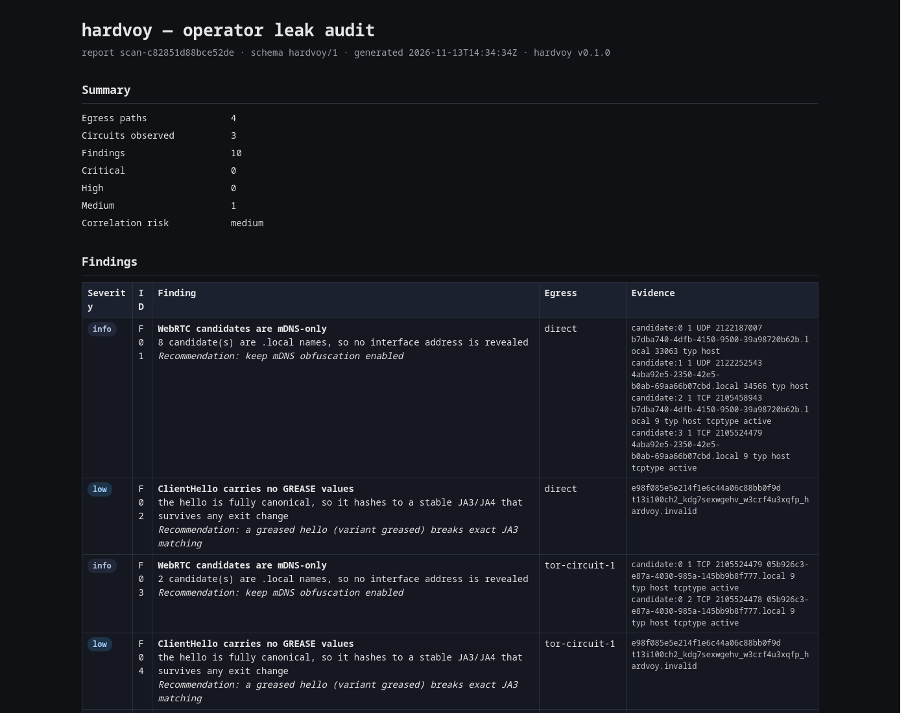
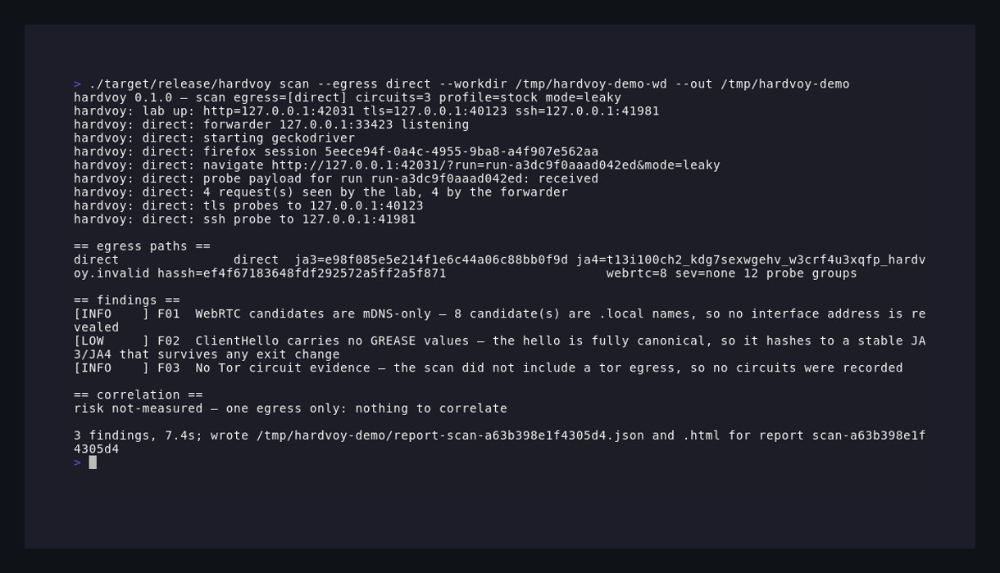
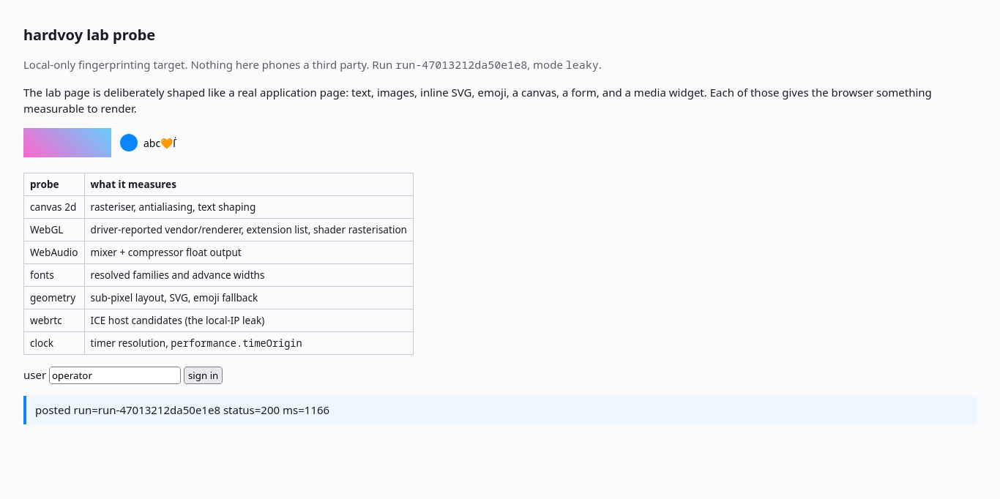
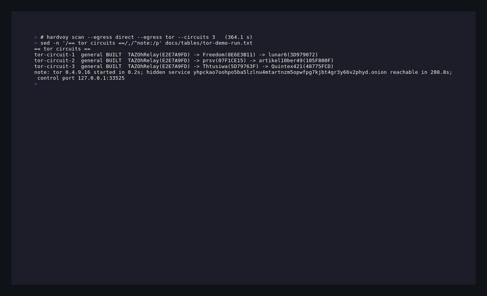
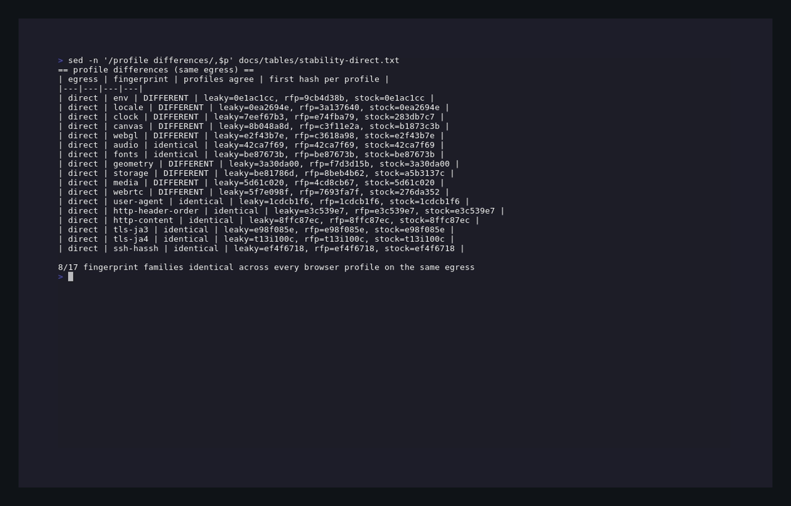

# hardvoy — operator opsec & fingerprint auditor

🔴 red team / opsec · Rust, no runtime deps

`hardvoy` measures the leak surface an operator puts on the wire *before* the
operator touches a target: WebRTC interface-address leaks, canvas/WebGL/audio/
font/geometry fingerprint hashes, timezone and locale consistency, TLS
(ClientHello) and SSH (KEXINIT) wire fingerprints, HTTP header ordering — and
then it tells you which of those actually change when you switch egress to Tor,
and which do not.

It audits **your own** machine against **its own** lab: the target is an HTTP +
TLS + SSH listener on `127.0.0.1` that `hardvoy` starts itself, republished as a
v3 onion service for the Tor paths. Nothing is sent to a third-party
fingerprinting service, so every number in this file is reproducible on your
machine instead of depending on someone else's uptime.


The HTML report, from the definition-of-done run (`--egress direct --egress tor
--circuits 3`: four egress paths, three circuits, correlation risk medium):



Terminal output of a direct scan — the same command `make demo-direct` runs,
and the same one `assets/demo.cast` records in asciinema:



The lab page it audits — shipped in this repository, served on `127.0.0.1`, and
deliberately shaped like a real application page so the browser has something
plausible to render:



## The claim, and the evidence for it

Definition of done for this project, run on Arch (CachyOS `7.3.0-4-cachyos`,
Firefox 160, Tor 0.4.9.16, 2026-11-13):

| requirement | measured result |
|---|---|
| `hardvoy scan --egress direct --egress tor --circuits 3` produces HTML + JSON with zero crashes, over three distinct Tor circuits | 4 egress views, 3 distinct circuits (entry guard `TAZOhRelay` on all three — that is how Tor works — exits `lunar6`, `artikel10ber49`, `Quintex421`), 10 findings, exit 0, 364.1 s, every path measured with 12 probe groups and no errors |
| detects a deliberately leaked WebRTC local-IP in the bundled lab page | `--profile leaky` (mDNS obfuscation off) → `[HIGH] WebRTC ICE candidates expose interface addresses … private: [192.168.8.88]; public: [2001:8f8:2d87:5e9f:…]`; stock profile → `[INFO] mDNS-only`, severity `none` |
| fingerprint hashes stable across repeat runs on the same egress, differ across egress/browser profiles; stability rate over ≥5 runs each | 37/51 stable on the direct egress (5 runs × 3 profiles), 13/17 stable on a Tor circuit (5 runs); 9 of 17 families change when you change browser profile — tables below |
| ≥15 tests; report renders fully offline | 133 unit tests + 2 live-Tor integration tests (ignored by default); the HTML has no `<script>`, no `src=`, no external `href`, asserted by tests |



The same three circuits produce the *same* wire fingerprint as the direct
egress — JA3 `e98f085e5e214f1e6c44a06c88bb0f9d`, JA4
`t13i100ch2_kdg7sexwgehv_w3crf4u3xqfp_hardvoy.invalid`, HASSH
`ef4f67183648fdf292572a5ff2a5f871` — while the in-page groups move. That is the
correlation verdict the tool reports: **medium**, "Tor changes the network path
but not the identity". Nine of seventeen measured families are identical on
every path; eight differ. Full table: [`docs/tables/tor-demo-run.txt`](docs/tables/tor-demo-run.txt).

A caveat the tool reports rather than hides: an earlier run of the same command
over a cold onion service lost one circuit's browser probe to a navigation
timeout and printed `errors=3` on that egress (`F05`/`F06`/`F07`). Onion page
loads now get a 180 s script timeout plus one retry, and the reference run
above measured all four paths cleanly; the flaky run is written up in
[PROGRESS.md](PROGRESS.md) rather than quietly dropped.

## Stability across repeat runs, and across profiles

`make stability` runs `hardvoy stability --egress direct --profiles stock,rfp,leaky --runs 5`
(5 runs per profile, 15 scans). The interesting half is the second table: it is
what tells you whether switching browser profile buys you anything.



37 of 51 fingerprint families are identical across every run of the same
profile and egress. The 14 that are not — `canvas`, `clock`, `storage` and
`webrtc` under every profile, plus `geometry` and `webgl` under `rfp` — are the
ones the lab deliberately makes jittery (sub-millisecond timers, sub-pixel
layout, per-run WebRTC candidates), because a tool that called them stable
identifiers would be lying. The
`profile differences` table counts 8/17 identical and 9/17 different: notably
`tls-ja3`, `tls-ja4`, `ssh-hassh`, `user-agent`, `http-header-order`, `fonts`
and `audio` do **not** move when you switch to the `rfp` profile, while
`env`, `locale`, `canvas`, `webgl`, `geometry`, `media`, `clock` and `storage`
do. Verbatim output: [`docs/tables/stability-direct.txt`](docs/tables/stability-direct.txt).

## Quick start (Arch)

```bash
sudo pacman -S --needed firefox geckodriver        # scan
sudo pacman -S --needed tor                        # tor egress (optional)

git clone https://github.com/mandoof1/hardvoy && cd hardvoy
make release && make test                          # 133 tests, offline
make demo-direct                                   # one egress, ~4 s
make demo                                          # direct + 3 Tor circuits, ~6 min
```

`make test` is the CI job: it needs no browser, no Tor and no network.
Everything is offline: `cargo test --all-targets`.

## Commands

| command | what it does |
|---|---|
| `hardvoy scan --egress direct --egress tor --circuits 3` | the audit: lab + Firefox probe + wire probes per path, then JSON and HTML reports |
| `hardvoy stability --profiles stock,rfp,leaky --runs 5` | repeat scans, print the stability rate and the profile-difference table |
| `hardvoy compare a.json b.json …` | fingerprint-by-fingerprint same/differs matrix across saved reports |
| `hardvoy report --json x.json` | re-render a saved report's HTML (used by CI on the committed fixtures) |
| `hardvoy lab --seconds 30 --dump` | just serve the lab page and show what it captured |
| `hardvoy tls-self --variant both` | fingerprint the stock and the GREASEed ClientHello, with the lab's independent hash for cross-checking |
| `hardvoy tls-parse --hex …` / `--file …` | parse a ClientHello captured somewhere else |
| `hardvoy ssh-probe --host H --port 22` | KEXINIT both ways, HASSH and HASSHServ |
| `hardvoy webrtc-audit --file candidates.txt` | classify ICE candidates (mDNS / private / public) and exit 1 on a real leak |
| `hardvoy tor-probe --rounds 3` | start Tor, publish the lab as an onion service, print circuits |
| `hardvoy tools` | versions of the tools a scan depends on |

## What a scan reports

* one view per egress path: browser groups, ICE audit, captured HTTP requests
  (header set, **order**, and a content hash), TLS hellos (versions, cipher
  order, extension order, ALPN, GREASE, JA3/JA4/Akamai-style strings), the SSH
  KEXINIT both directions with HASSH and the lab's independent confirmation,
  the pinned Tor circuit (relay fingerprints + nicknames + the raw
  `circuit-status` line), and an explicit `errors` list for anything that did
  not measure.
* findings with severity and evidence — e.g. `F01 [HIGH] WebRTC ICE candidates
  expose interface addresses`, `F02 [LOW] ClientHello carries no GREASE values
  …`, `F12 [MEDIUM] Same operator identity across every egress path`.
* a correlation verdict: which fingerprints are identical on every path, which
  differ, and how linkable the operator is as a result.
* timings for every stage (`tor_ready`, per-path probe time, …) straight out of
  the JSON, so the README's timing table is the tool's own numbers.

## Timing (from `make bench`, same machine)

Full table: [`docs/BENCH.md`](docs/BENCH.md).

| stage | 3 direct runs (mean / min / max s) |
|---|---|
| `scan_total` | 4.26 / 3.42 / 5.67 |
| `egress_direct` (lab + Firefox probe + wire probes) | 3.61 / 3.15 / 4.40 |

The committed Tor run, from the report JSON in `tests/fixtures/`:

| stage | seconds |
|---|---|
| `scan_total` | 364.1 |
| `tor_ready` (bootstrap + onion publication to first successful fetch) | 208.8 |
| `egress_tor` (three circuits, browser + wire probes each) | 147.9 |
| `egress_direct` | 5.6 |

The test suite itself runs in **0.7 s** wall time (133 tests).

## Honesty — what this does **not** claim

* One browser family: Firefox. There is no Chromium probe and no claim of one.
* The Tor egress is measured over the tool's own Tor instance, because circuit
  evidence requires a control port. `hardvoy tls-self --through-socks 127.0.0.1:9050`
  will use your system Tor for a single probe, but `scan` never does: a Tor
  without a control port cannot promise NEWNYM rotation, and the tool refuses to
  claim circuit rotation it cannot prove.
* JA3/JA4/HASSH are computed by this repository's own parsers from the bytes the
  lab received; `raw` components are printed in the report so a hash can be
  checked by hand. Where the JA4 shape is a subset of the vendor algorithm, the
  report says so rather than pretending otherwise.
* Five lab probes jitter on purpose (see [docs/METHOD.md](docs/METHOD.md)), so a
  100 % stability score is not the goal of this tool; a defensible one is.
* Flakiness is reported, not hidden: an egress that loses a probe keeps its
  `errors=[…]` list and gains a `Probe incomplete` finding. In an earlier run
  against a cold onion service one circuit recorded `SOCKS5 connect refused
  (reply 0x01: general SOCKS server failure)` plus a navigation timeout and lost
  its browser probe entirely — the report said `no browser probe` instead of
  pretending. The current build gives onion page loads a 180 s timeout and one
  retry, which is what makes the reference run above clean; the older behaviour
  is kept in [PROGRESS.md](PROGRESS.md) rather than hidden.

## Tests

`cargo test --all-targets` → **133 unit tests**, no network, no browser:

| module | covers |
|---|---|
| `tlsf` | ClientHello parse/build, JA3/JA4/Akamai hashing, GREASE detection, extension edge cases |
| `sshf` | SSH packet framing, KEXINIT parse/build, HASSH |
| `httpf` | request parsing, header order vs content hashing, port normalisation |
| `webrtc` | ICE candidate classification, severity, mDNS handling |
| `lab` / `forwarder` | capture on loopback, CONNECT proxy, socks5 upstream |
| `wd` | WebDriver framing, Firefox preference set, JS syntax checks on the probe collector |
| `page` | probe JS integrity (brace balance, every group defined and awaited) |
| `tor` | `circuit-status` parsing for Tor 0.4.9 and legacy formats, control-port reply framing, a fake control-port server |
| `scan` | circuit choice (no shared exit, no two-hop, no service-side circuit, fresh path fallback), report plumbing |
| `report` | HTML generation incl. offline-render and escaping assertions, JSON round trip |

Plus two ignored live tests (`cargo test --ignored`) that need a working Tor and
network: `tests/tor_live.rs`, `tests/tor_fetch_probe.rs`.

## Layout

```
src/
  main.rs        subcommands
  scan.rs        the per-egress pipeline, circuit choice, findings, correlation
  lab.rs         loopback HTTP/TLS/SSH lab + capture
  page.rs        the probe collector served to the browser
  wd.rs          W3C WebDriver client + Firefox profiles
  tor.rs         own Tor instance, onion service, control port, circuit-status
  forwarder.rs   CONNECT proxy: direct or SOCKS5 (Tor) upstream
  socks.rs       SOCKS5 client
  tlsf.rs        ClientHello parse/build + JA3/JA4/Akamai-style + GREASE
  sshf.rs        SSH version/KEXINIT + HASSH
  httpf.rs       HTTP request parse, header order/content hashes
  webrtc.rs      ICE candidate audit
  report.rs      JSON model + self-contained HTML
  util.rs        hashing, free ports, canonical JSON
assets/          .tape files + generated PNG/GIF/cast (make assets)
docs/            METHOD.md, SOURCES.md, BENCH.md, tables/ (verbatim run output)
tests/           live Tor tests + fixtures committed from real runs
examples/        two small library-usage examples (probe JS dump, WebDriver walkthrough)
tools/           bench.sh, make-assets.sh
```

## Rebuilding the images

```bash
make assets          # scans, screenshots, tables, vhs tapes, asciinema cast
RUN_TOR=1 make assets  # also re-runs the 7-minute Tor audit
```

## License / author

MIT — see [LICENSE](LICENSE).

Hadi Abdulrahman — GitHub [`mandoof1`](https://github.com/mandoof1),
`haadii2005@gmail.com`.
